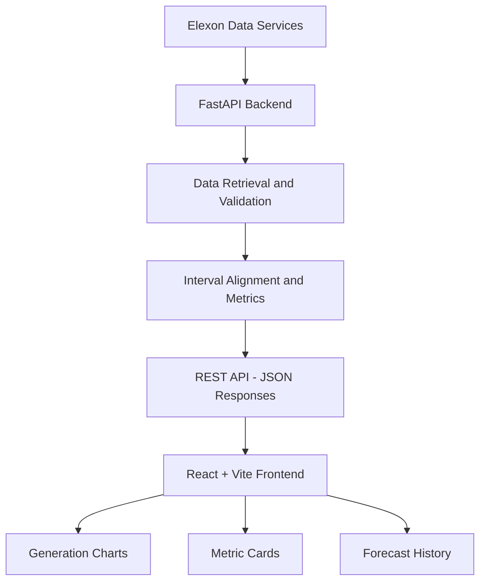

 <div align="center">

# 🌬️ UK Wind Forecast Analytics

### Explore actual wind generation. Compare forecasts. Understand forecast error.

A full-stack analytics dashboard for UK wind generation data from Elexon, built with **React, Python, and FastAPI**. It brings actual generation, forecast history, and forecast-performance metrics into one place.

[](https://react.dev/)
[](https://vite.dev/)
[](https://www.python.org/)
[](https://fastapi.tiangolo.com/)
[](https://www.elexon.co.uk/)

**Repository:** [srashtishukla-dev/wind-forecast](https://github.com/srashtishukla-dev/wind-forecast)

</div>

---

## 📌 Project Overview

Wind generation changes with weather conditions, making forecast accuracy important when planning around changing electricity supply. This project provides an interactive dashboard for exploring UK wind-generation data and understanding how forecasts compare with actual generation across delivery intervals.

Instead of working directly with raw API responses, users can explore generation trends, review forecast versions, and analyse forecast errors through a single interface.

### ✨ Key Features

- **Actual Generation Analysis:** Explore reported wind generation across delivery intervals.
- **Forecast Comparison:** Compare forecast values with actual generation for matching delivery intervals.
- **Forecast History:** Inspect forecast versions and understand how predictions change over time.
- **Forecast Accuracy Metrics:** Calculate Mean Absolute Error (MAE), Root Mean Squared Error (RMSE), and forecast bias.
- **Interactive Dashboard:** Present generation trends and analytical results through charts and metric cards.
- **REST API Integration:** Retrieve and process Elexon data through a dedicated FastAPI backend.
- **Data Processing and Validation:** Align forecast and actual observations while accounting for missing or invalid values.
- **Automated Testing:** Test backend API behaviour, data-processing logic, metrics, and frontend utility functions.

> **Project scope:** This is an analytics and decision-support application. It is not a trading system and does not guarantee future generation or forecast accuracy.

## 🎯 Business Problem

Wind generation is variable, and forecasts may change as new information becomes available. Looking at a forecast alone does not reveal how accurately it predicted actual generation.

This project focuses on three practical questions:

1. **What happened?** How did actual wind generation change over the selected period?
2. **What was forecast?** What did the available forecast predict for the same delivery intervals?
3. **How well did it perform?** How large were the forecast errors, and did forecasts tend to overestimate or underestimate generation?

By bringing these views together, the dashboard makes forecast performance easier to explore and explain.

## 📊 Forecast Performance Metrics

The application uses standard error metrics to compare valid, aligned forecast and actual observations.

| Metric | Definition | Interpretation |
|---|---|---|
| **MAE — Mean Absolute Error** | Mean of the absolute forecast errors | Lower values indicate smaller average errors |
| **RMSE — Root Mean Squared Error** | Square root of the mean squared forecast errors | Lower values are better; large errors receive more weight |
| **Bias** | Mean of `forecast − actual` | Positive means over-forecasting; negative means under-forecasting |

Metrics are meaningful only when forecast and actual values refer to the same delivery intervals and compatible units. Missing or invalid generation values should remain missing rather than being silently treated as zero.

### Forecast Version and Timing

Forecast publication time and delivery time are different. Since forecasts can be revised, historical evaluation needs a consistent rule for selecting which forecast version to compare with actual generation.

The configured forecast lead time is an analytical assumption for this project, not an official Elexon deadline. Refer to the backend configuration and implementation for the precise selection rule used by this version.

## 🏗️ System Architecture



### How It Works

1. **Data retrieval:** The Python backend requests wind-generation and forecast information from Elexon.
2. **Data processing:** The backend validates and prepares source data for analysis.
3. **Forecast comparison:** Forecast and actual observations are aligned by delivery interval.
4. **Metric calculation:** The application calculates forecast error metrics from valid matched observations.
5. **API response:** FastAPI exposes the processed information through REST endpoints.
6. **Visualisation:** React presents the information through charts, summary cards, and forecast-history views.

## 🧰 Technology Stack

| Layer | Technologies | Purpose |
|---|---|---|
| Frontend | React, Vite, JavaScript, CSS | Dashboard interface, charts, and interactions |
| Backend | Python, FastAPI | REST API endpoints, configuration, and request handling |
| Data Source | Elexon API | Actual wind generation and forecast data |
| Analytics | Python data-processing and metrics modules | Interval alignment and forecast-error calculations |
| Testing | Pytest, frontend test tooling, ESLint | Automated tests and code-quality checks |
| Version Control | Git, GitHub | Source-code management and project collaboration |

## 🗂️ Project Structure

```text
wind-forecast/
├── backend/
│   ├── app/
│   │   ├── api/
│   │   │   └── routes.py
│   │   ├── services/
│   │   │   ├── elexon_client.py
│   │   │   ├── data_processing.py
│   │   │   └── metrics.py
│   │   ├── config.py
│   │   ├── main.py
│   │   └── models.py
│   ├── tests/
│   ├── requirements.txt
│   └── .env.example
├── frontend/
│   ├── src/
│   │   ├── api/
│   │   ├── components/
│   │   ├── utils/
│   │   ├── App.jsx
│   │   └── main.jsx
│   ├── package.json
│   └── .env.example
├── .gitignore
└── README.md
```

## 🚀 Getting Started

Follow these steps to run the project locally.

### Prerequisites

- Python installed and available on your PATH
- Node.js and npm
- Internet access for live Elexon data requests

### 1. Clone the Repository

```bash
git clone https://github.com/srashtishukla-dev/wind-forecast.git
cd wind-forecast
```

### 2. Set Up the Backend

From the repository root, run these commands in Windows Command Prompt:

```bat
cd backend
python -m venv .venv
.venv\Scripts\activate
python -m pip install -r requirements.txt
copy .env.example .env
uvicorn app.main:app --reload
```

The backend should now be available at:

- **API:** `http://127.0.0.1:8000`
- **Interactive API documentation:** `http://127.0.0.1:8000/docs`
- **Health check:** `http://127.0.0.1:8000/health`

Keep this terminal running while using the frontend.

### 3. Set Up the Frontend

Open a **second Command Prompt window** and navigate to the `frontend` directory in your cloned repository.

```bat
cd path\to\wind-forecast\frontend
npm install
copy .env.example .env
npm run dev
```

Replace `path\to\wind-forecast` with your actual project location.

Open the local URL printed by Vite, usually:

`http://localhost:5173/`

If the dashboard cannot reach the backend, verify that the backend is running and that the frontend API URL and backend CORS settings are configured correctly. Check `frontend/.env.example` for the exact variable names used by this project.

**Security note:** Never commit real `.env` files, API secrets, or credentials. Frontend environment variables exposed by Vite may be visible in the browser.

## 🔌 API Endpoints

The FastAPI backend exposes the following routes:

| Endpoint | Purpose |
|---|---|
| `GET /health` | Check API health |
| `GET /api/actuals` | Retrieve actual wind-generation data |
| `GET /api/forecasts` | Retrieve forecast data |
| `GET /api/forecast-accuracy` | Compare forecasts with actuals and calculate error metrics |
| `GET /api/forecast-versions` | Retrieve forecast-version/history information |

To inspect the exact query parameters, response schemas, and supported requests, run the backend and open:

[**Interactive API documentation — Swagger UI**](http://127.0.0.1:8000/docs)

The interactive API documentation is the source of truth for the parameters supported by the current implementation.

## 🧪 Testing and Quality Checks

### Backend Tests

Run from the `backend` directory with the virtual environment activated:

```bash
python -m pytest -q
```

**Last recorded result:** 28 tests passed. A Starlette deprecation warning was also reported; it did not cause the tests to fail.

### Frontend Checks

Run from the `frontend` directory:

```bash
npm run lint
npm run build
```

The frontend lint and production build completed successfully in the last recorded local check. Check `frontend/package.json` for the available frontend test scripts before running additional tests.

Re-run these checks after making changes and before submitting the project.

## 🧭 Data Methodology and Limitations

- **Data source:** Elexon public electricity-market data. Refer to Elexon's documentation for endpoint definitions and publication conventions.
- **Delivery intervals:** Forecast and actual observations must be aligned to the same delivery intervals before calculating errors.
- **Forecast versions:** Results depend on which forecast publication is selected for each delivery interval and the configured decision-time rule.
- **Missing values:** Missing, unavailable, or invalid source values are not equivalent to zero generation.
- **Units:** Confirm the relevant Elexon endpoint's unit definition before labelling values as MW or another specific unit.
- **Data availability:** Historical forecast publications may be unavailable or incomplete. An empty API response does not prove that generation was zero.
- **Interpretation:** Forecast metrics describe the observations and methodology used; they do not guarantee future performance.

## 🚢 Deployment

The frontend and backend can be deployed separately.

- **Frontend:** Vercel or another static frontend hosting platform.
- **Backend:** A hosting platform that supports Python and FastAPI.
- **Production configuration:** Set the frontend API base URL to the deployed backend address and configure backend CORS to allow the deployed frontend origin.
- **Health check:** Verify the deployed backend using `/health`.

**Live dashboard:** Add the public deployment URL after deployment and end-to-end testing.

**Live API documentation:** Add the deployed backend `/docs` URL after deployment and testing.

Do not describe the project as deployed until both services have been tested together.

## 🔭 Future Improvements

- Add CSV export for filtered generation and forecast data.
- Compare forecast performance across different lead-time periods.
- Improve data-freshness and source-availability indicators.
- Add automated CI checks and deployment health monitoring.
- Provide a clearly labelled sample-data mode when the live API is unavailable.

## 🤖 AI Use Disclosure

AI coding assistance, including GitHub Copilot and ChatGPT where used, supported parts of implementation, debugging, documentation, and test development. The project was run and checked locally, and the author is responsible for understanding the implementation, validating outputs, and explaining design decisions. This disclosure should accurately reflect the tools used during development.

## 👩‍💻 Author

**Srashti Shukla**

- GitHub: [@srashtishukla-dev](https://github.com/srashtishukla-dev)
- Project Repository: [UK Wind Forecast Analytics](https://github.com/srashtishukla-dev/wind-forecast)

---

<div align="center">

**Making wind forecast performance easier to explore and explain.**

</div>